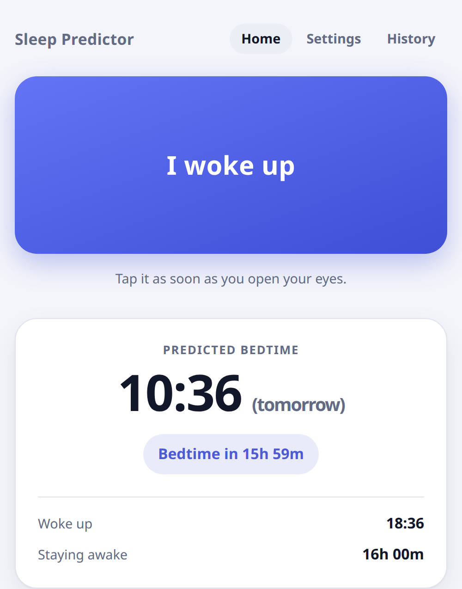

# Sleep Predictor

An Android-friendly Progressive Web App (PWA) that predicts when you should go
to sleep next, based on when you woke up.

Tap one big button when you wake up, and the app tells you when to go to bed.

**Live app:** <https://woteq-tools.github.io/predict-sleep/>



## Goal

Most of us do not know how much sleep we actually need. This app makes the rule
explicit and enforceable:

> **bedtime = wake-up time + awake duration** (default **16 hours**)

Tap **"I woke up"** at 7:00 AM and the app shows **"Predicted bedtime:
11:00 PM"**, together with a live countdown so you always know how long you
have left.

## Spec

### Core behavior

- The home screen has a single large button labeled **"I woke up"**.
- When the user taps it, the app records the current time as the wake-up time.
- The app then adds a configurable **awake duration** (default: **16 hours**) to
  the wake-up time and displays the predicted bedtime.
- Example: if the user taps the button at 7:00 AM, the app shows
  `Predicted bedtime: 11:00 PM`.

### Settings

- A settings screen lets the user change the awake duration (default 16 hours,
  adjustable in **15-minute steps**).
- The setting is saved and applied to all future predictions.

### Display

- Show the last wake-up time, the predicted bedtime, and a live countdown
  (`Bedtime in 9h 32m`).
- Use the device's local time zone and the user's 12/24-hour format.

### Optional features

- Send a notification **30 minutes before** the predicted bedtime.
- Keep a simple **history** of past wake-up times and bedtimes.

### Technical requirements

- Installable PWA with a manifest and a service worker, working **offline**.
- Store all data **locally** (localStorage). No backend or account is required.
- Mobile-first, clean, minimal UI with **dark mode** support.
- Handle edge cases: tapping the button twice, a predicted time that falls on
  the next day, and time zone changes.

## Features

| | |
| --- | --- |
| **One tap prediction** | Tap *I woke up* and the bedtime is computed for you. |
| **Live countdown** | `Bedtime in 9h 32m`, updated every second. |
| **Configurable** | Awake duration from 1h to 24h in 15-minute steps. |
| **Edge case safe** | Double taps are caught, a bedtime on the next day is labelled `(tomorrow)`, a passed bedtime reads `Bedtime was 20m ago`. |
| **Undo** | A short lived toast lets you undo a wake-up that was recorded by accident. |
| **History** | The last 60 wake-ups with their bedtimes. |
| **Reminder** | An optional notification 30 minutes before bedtime. |
| **Offline** | The whole app is precached and works without a network. |
| **Dark mode** | Follows the system setting. |
| **No account** | Everything stays on the device. |

## Install it on Android

The app has to be served over **HTTPS** (or `localhost`), because browsers only
allow service workers and install prompts on secure origins.

1. Open the app URL in **Chrome** on your phone.
2. Tap the **⋮** menu in the top right corner.
3. Tap **Install app**.
   - On some Android versions the entry is called **Add to Home screen**; then
     confirm with **Install**.
   - Chrome sometimes shows an **"Add to Home screen"** banner at the bottom of
     the screen instead - tapping that works too.
4. Confirm with **Install**.

The app is now on your home screen and in the app drawer. It opens full screen
without the address bar, just like a native app.

**Handy extra:** long press the app icon and pick **"I woke up"** to record a
wake-up without opening the app first.

To remove it again: long press the icon → **Uninstall**.

## Run it locally

```bash
npm run serve        # python3 -m http.server 8000
```

Open <http://localhost:8000>. `localhost` is treated as a secure context, so
the service worker, the install prompt and notifications all work there too.

> The app uses ES modules, so it must be served over HTTP(S). Opening
> `index.html` directly from the file system does not work.

## Tests

```bash
npm test             # node --test
```

The unit tests cover the time helpers and the storage layer. The same checks
can also be run in a browser by opening `tests/tests.html`.

The full manual checklist lives in [QA.md](QA.md).

## Tech stack

Plain HTML, CSS and JavaScript. No build step, no framework, no runtime
dependencies.

| File | Purpose |
| --- | --- |
| `index.html` | App shell and all three views (home / settings / history) |
| `styles.css` | Mobile-first styling, CSS variables, dark mode |
| `app.js` | View routing, rendering, event wiring, countdown, notifications |
| `time.js` | Pure time helpers (prediction, formatting, countdown) |
| `storage.js` | Safe `localStorage` wrappers and the data model |
| `sw.js` | Service worker: precache, cache-first serving, offline support |
| `manifest.json` | Web app manifest for installability |
| `icons/` | App icons (192, 512, maskable 512, apple touch, favicon) |
| `scripts/` | Icon generator |
| `tests/` | Unit checks (Node test runner + a browser page) |

### Architecture notes

- **Pure logic lives in `time.js`.** It has no DOM or storage dependencies, so
  it can be unit tested directly under Node.
- **Timestamps are stored as epoch milliseconds** and the awake duration as an
  **integer number of minutes**. Both are absolute and timezone agnostic, which
  makes time zone changes a non-issue for the stored data.
- **Formatting uses `Intl.DateTimeFormat(undefined, ...)`,** so times follow the
  device locale's 12/24-hour preference and the device's local time zone
  automatically.
- **"Which calendar day?" is answered with local calendar parts**, not with a
  fixed 24 hour offset, so a daylight saving change cannot mislabel a bedtime
  as being on the next day.
- **The service worker caches the app shell with a version in the URL.** When
  the app changes, `CACHE_VERSION` in `sw.js` is bumped, the new worker
  precaches fresh files and the old cache is dropped.

## Deployment

See [DEPLOY.md](DEPLOY.md). The repository ships with a GitHub Actions workflow
that publishes the app to GitHub Pages on every push to `main`.

## Known limitations

- **The reminder only fires while the app is open** (or in the background on
  Android). A web app cannot reliably run a scheduled task when it is closed:
  the Notification Triggers API was discontinued, and guaranteed background
  delivery would need a push server, which this project deliberately avoids.
- **Data is per browser.** Clearing the browser data also clears the history.
  There is no backup and no sync.

## License

MIT
